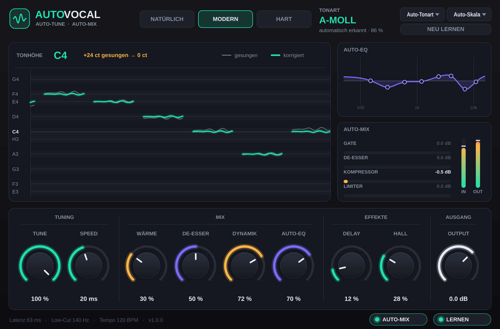

# AutoVocal – Autotune & Auto-Mix Plugin für Mac



AutoVocal ist ein Gesangs-Plugin, das **selbstständig** arbeitet: Es erkennt die Tonart,
zieht jeden Ton auf die richtige Note und mischt die Stimme automatisch ab – EQ,
De-Esser, Kompressor, Wärme, Delay, Hall und Limiter stellen sich von alleine ein und
regeln laufend nach, bis die Stimme ausgewogen klingt.

**Formate:** Audio Unit (GarageBand, Logic Pro) · VST3 (Ableton, FL Studio, Cubase, Reaper, Studio One) · eigenständige App
**Mac:** Apple Silicon (M1–M4) und Intel, ab macOS 10.15

---

## Installation

1. Unter **[Releases](../../releases)** die neueste `AutoVocal-Installer.pkg` herunterladen.
2. Doppelklick auf die Datei.
   macOS sagt eventuell, dass die App von einem „nicht verifizierten Entwickler“ stammt
   (das Plugin ist nicht bei Apple kostenpflichtig registriert). Dann:
   **Systemeinstellungen → Datenschutz & Sicherheit → ganz unten „Dennoch öffnen“** klicken.
3. Installer durchklicken (Passwort eingeben).
4. GarageBand bzw. Logic **neu starten**.

## Benutzung in GarageBand / Logic

1. Gesangsspur auswählen → **Plug-ins** → **Audio Units → AutoVocal → AutoVocal**.
2. Oben den **Stil** wählen:
   - **Natürlich** – sanfte Korrektur, Vibrato bleibt erhalten
   - **Modern** – sauberer, moderner Pop/Rap-Sound
   - **Hart** – der typische Roboter-Autotune-Effekt (T-Pain)
3. Song abspielen. In den ersten Sekunden steht oben **LERNT** – AutoVocal erkennt
   die Tonart und analysiert deine Stimme. Danach erscheint die Tonart (z. B. „A-MOLL“).
4. Fertig. Alles Weitere macht das Plugin automatisch.

### Die Regler (optional)

| Regler | Bedeutung |
|---|---|
| **Tune** | Wie stark korrigiert wird (100 % = voll) |
| **Speed** | Wie schnell auf den Ton gezogen wird (0 ms = Robot-Effekt, 70 ms = natürlich) |
| **Wärme** | Sanfte Sättigung für einen volleren Klang |
| **De-Esser** | Zähmt scharfe S- und Zischlaute |
| **Dynamik** | Wie gleichmäßig die Lautstärke gehalten wird |
| **Auto-EQ** | Wie stark der automatische EQ den Klang angleicht |
| **Delay** | Echo im Songtempo |
| **Hall** | Raumanteil |
| **Output** | Ausgangslautstärke |

**Tonart / Skala:** Steht auf *Auto*. Wenn du die Tonart deines Beats kennst, kannst du
sie auch fest einstellen (z. B. *A* + *Moll*). *Chromatisch* korrigiert auf alle Halbtöne.

**Lernen:** Wenn dir der Sound gefällt, schalte *Lernen* aus – dann bleiben alle
automatisch gefundenen Einstellungen exakt so. Sie werden mit dem Projekt gespeichert.
**Neu lernen** setzt alles zurück (z. B. für einen anderen Song).

**Auto-Mix:** Aus = nur Autotune, ohne automatisches Mixing.

### Tipps

- AutoVocal braucht für seine Analyse etwa 60 ms Vorlauf. GarageBand und Logic gleichen
  das automatisch aus. **Beim Aufnehmen** am besten ohne Plugin einsingen und AutoVocal
  danach einschalten (oder in Logic den „Low Latency Mode“ benutzen).
- Die Stimme möglichst trocken (ohne Hall) aufnehmen und nicht übersteuern.
- Die **AutoVocal.app** (im Programme-Ordner) funktioniert auch ohne Musikprogramm: Mikrofon
  wählen, Kopfhörer aufsetzen, singen.

## Was im Inneren passiert

```
Stimme ─► Tonhöhenerkennung (YIN) ─► Tonart lernen ─► Tonhöhe korrigieren (PSOLA, Formanten bleiben)
       ─► Low-Cut (passt sich der Stimmlage an) ─► Rausch-Gate ─► Auto-EQ (misst & gleicht an)
       ─► De-Esser ─► Kompressor (regelt Dynamik auf Zielwert) ─► Wärme ─► Auto-Gain
       ─► Delay + Hall (ducken beim Singen) ─► Limiter (-1 dB) ─► Ausgang
```

## Selbst bauen (für Entwickler)

```bash
cmake -B build -DCMAKE_BUILD_TYPE=Release -DCMAKE_OSX_ARCHITECTURES="arm64;x86_64"
cmake --build build --config Release
```

JUCE wird automatisch heruntergeladen. Die Mac-Version wird bei jedem Push von GitHub
Actions gebaut, mit `auval` geprüft und als Installer unter *Releases* veröffentlicht.

Offline-Test der Engine (Linux/Mac): `-DAUTOVOCAL_BUILD_TESTS=ON`, dann
`AutoVocalRender gesang.wav ergebnis.wav modern 2`.

Gebaut mit [JUCE](https://juce.com) (AGPLv3).
